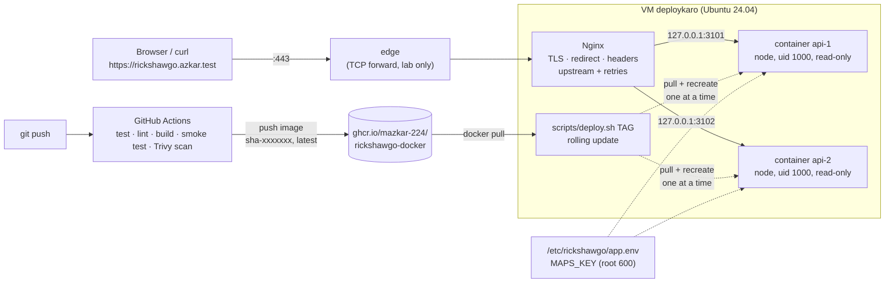

# RickshawGo API, Dockerized

[](https://github.com/mazkar-224/rickshawgo-docker/actions/workflows/ci.yml)

**DevOps bootcamp, Assignment 4: Deploy a dockerized Node.js application.**
The RickshawGo API (Node.js 24 / Express) deployed in the previous assignments, now:

1. **Dockerized**: a small, non-root, health-checked image, built, tested and scanned by GitHub Actions and published to `ghcr.io`
2. **Deployed to the VM**: two containers managed by Docker Compose, updated with a zero-downtime rolling deploy that rolls back automatically
3. **Behind Nginx**: TLS termination, HTTP to HTTPS redirect, load balancing over both containers, retries, security headers
4. **On a domain with an SSL certificate**: `https://rickshawgo.azkar.test` (TLS 1.2/1.3, certificate verified, no `-k` anywhere)

**Proof of work: [docs/PROOF.md](docs/PROOF.md)** (real output from the VM, the Mac and GitHub Actions).

---

## Architecture



| Piece | File | What it does |
|---|---|---|
| Image | [`app/Dockerfile`](app/Dockerfile) | multi-stage, `npm ci --omit=dev`, runs as uid 1000, code owned by root, no npm/yarn in the runtime image, `HEALTHCHECK` in plain Node |
| App changes for containers | [`app/server.js`](app/server.js) | listen address from `HOST` (was hard-coded to 127.0.0.1, which is unreachable from outside a container), graceful `SIGTERM` shutdown, `instance` (hostname) in `/api/health` |
| Tests | [`app/test/api.test.js`](app/test/api.test.js) | 5 tests with Node's built-in runner, against the real server |
| Runtime on the VM | [`compose.yaml`](compose.yaml) | two containers, ports only on 127.0.0.1, `read_only`, `cap_drop: ALL`, `no-new-privileges`, `init`, CPU/memory limits, log rotation, `restart: unless-stopped` |
| Deploy | [`scripts/deploy.sh`](scripts/deploy.sh) | pull a CI-built tag, replace api-1, wait until healthy, then api-2; automatic rollback if a container doesn't become healthy |
| Reverse proxy | [`nginx/rickshawgo.conf`](nginx/rickshawgo.conf) | HTTP → HTTPS 301, TLS, HSTS + security headers, `upstream` with shared `zone`, `keepalive`, `proxy_next_upstream` |
| | [`nginx/00-default-tls.conf`](nginx/00-default-tls.conf) | unknown host names are refused at the TLS handshake (`ssl_reject_handshake`) |
| Certificate | [`scripts/make-cert.sh`](scripts/make-cert.sh), [`ssl/azkar-lab-root-ca.crt`](ssl/azkar-lab-root-ca.crt) | issues the server certificate (SAN, P-256, 397 days) from a private lab CA. Only the CA's *public* certificate is in the repo |
| CI | [`.github/workflows/ci.yml`](.github/workflows/ci.yml) | unit tests · hadolint · shellcheck · compose validation · build · container smoke test (healthy, non-root, clean SIGTERM) · Trivy scan · publish to ghcr.io with SBOM + provenance |
| Updates | [`.github/dependabot.yml`](.github/dependabot.yml) | weekly PRs for the base image, npm packages and actions |

## Deploying

The pipeline builds every commit; deploying is one command on the VM, with the tag CI published (shown in each run's summary):

```bash
sudo /opt/rickshawgo/scripts/deploy.sh sha-a74aace
```

**Why the deploy isn't triggered by GitHub automatically:** this repository is **public**. A self-hosted runner on a public repository can be
used by anyone who opens a pull request to run code on the VM, and GitHub's own guidance is not to do that. The VM also isn't reachable from the
internet, so GitHub's machines can't SSH in. So CI does everything up to a tested, scanned image in a registry, and the VM *pulls* it. Nothing
ever has to connect in to the server, and no deploy credentials exist anywhere on GitHub.

### First-time setup on the VM (what I did)

```bash
# Docker Engine from Docker's official apt repository (docker-ce, compose plugin)
sudo git clone https://github.com/mazkar-224/rickshawgo-docker.git /opt/rickshawgo

# the secret: never in Git or in the image
sudo install -d -m 700 /etc/rickshawgo
echo 'MAPS_KEY=...' | sudo install -m 600 /dev/stdin /etc/rickshawgo/app.env

# TLS certificate (made with scripts/make-cert.sh on my laptop, where the CA key lives)
sudo install -d -m 755 /etc/ssl/rickshawgo
sudo install -m 644 fullchain.pem /etc/ssl/rickshawgo/
sudo install -m 600 privkey.pem  /etc/ssl/rickshawgo/

# Nginx
sudo cp nginx/rickshawgo.conf /etc/nginx/sites-available/rickshawgo
sudo cp nginx/00-default-tls.conf /etc/nginx/sites-available/00-default-tls
sudo ln -s /etc/nginx/sites-available/{rickshawgo,00-default-tls} /etc/nginx/sites-enabled/
sudo nginx -t && sudo systemctl reload nginx

sudo /opt/rickshawgo/scripts/deploy.sh sha-a74aace
```

### Using the domain from a laptop

```bash
echo "127.0.0.1 rickshawgo.azkar.test" | sudo tee -a /etc/hosts
curl --cacert ssl/azkar-lab-root-ca.crt https://rickshawgo.azkar.test/api/health
```
For a browser without a warning, import `ssl/azkar-lab-root-ca.crt` as a trusted root (macOS: Keychain Access → System → trust "Always").

## SSL: why a private CA, and how it works on a real domain

`.test` is a reserved top-level domain: it never resolves on the internet, so no public CA (Let's Encrypt) can validate it. In the lab I run my
own small CA: the root key stays on my laptop, outside this repository, and the server gets a certificate signed by it. Clients that trust
the root (`curl --cacert`, or a browser after importing it) get a fully verified connection.

On a real, public domain the same Nginx site works with Let's Encrypt. The port-80 block already serves `/.well-known/acme-challenge/`:
```bash
sudo apt install certbot
sudo certbot certonly --webroot -w /var/www/letsencrypt -d api.example.com
# then point ssl_certificate / ssl_certificate_key at /etc/letsencrypt/live/api.example.com/
# certbot.timer renews automatically; add a deploy hook: --deploy-hook "systemctl reload nginx"
```

## Security decisions

- **Image:** non-root (uid 1000); code and dependencies owned by root, so the app can't modify itself; no package managers at runtime; only production
  dependencies; `.dockerignore` keeps `.env` files and tests out of the build context. Trivy: **0 fixable HIGH/CRITICAL** vulnerabilities.
- **Container:** read-only root file system (+ a `tmpfs` /tmp), all Linux capabilities dropped, `no-new-privileges`, CPU and memory limits, rotated logs.
- **Network:** containers publish only on `127.0.0.1`, so the only way in is Nginx on 443. HTTP only redirects. TLS 1.2+ only; unknown SNI names
  are refused; `server_tokens off`; HSTS, `nosniff`, `X-Frame-Options`, `Referrer-Policy`. Express's `X-Powered-By` is disabled.
- **Secrets:** `MAPS_KEY` exists only in `/etc/rickshawgo/app.env` (root 600) on the VM. It's not in Git, not in the image (`docker image inspect`
  shows no key), and not in CI (tests use a fake key). The CA private key is not in this repository either.
- **CI:** `permissions: contents: read` by default; only the publish job may write packages, with the short-lived `GITHUB_TOKEN`. Images carry an SBOM and build provenance.

## Lab notes (honest differences from a cloud VM)

My "VM" is an Ubuntu 24.04 machine with systemd running as a container on my Mac (the same server as assignments 2–3). Two things exist only because of that:

- **Docker inside it needs a real file system.** The VM's root is overlayfs, and Docker can't stack its overlay layers on top of that
  (`failed to mount ... overlay ... invalid argument`). So `/var/lib/docker` and `/var/lib/containerd` live on a loop-mounted ext4 disk image,
  mounted at boot by systemd `.mount` units. On a normal VM, none of this is needed.
- **`lab/edge/`** is a 10-line Nginx TCP forwarder on the Mac (ports 80/443 → the VM), standing in for a router's port forwarding or a cloud load
  balancer in TCP mode. TLS is still terminated by Nginx on the VM.

The previous systemd-based deployment (`rickshaw.local`, assignment 3) keeps running unchanged next to this one.
